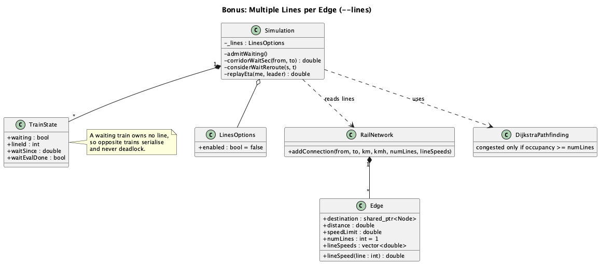
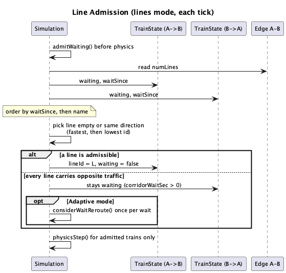

# Bonus: Multiple Lines per Edge (`--lines`)

An edge between two stations can hold several **lines**. Trains may use a line in
either direction, but two trains travelling in opposite directions never occupy the
same line at the same time (no head-on collisions).

Everything here is opt-in. Without `--lines` (and without the GUI "Multi-line rails"
checkbox) the simulation behaves exactly as the mandatory project.

## Input

```
Rail <A> <B> <distance_km> <speed_kmh> [numLines]
```

- `numLines` is only accepted with `--lines`; it must be an integer >= 1 (default 1).
  Anything else fails with `file:line: Invalid line count 'X' (expected an integer >= 1)`.
- Lines share the edge's distance; speed defaults to the edge speed. Rail events affect every line.
- Optional per-line speeds: `Rail A B km kmh N s1 ... sN` (exactly N positive km/h values). A free
  line is chosen fastest-first, and the train runs at that line's speed.
- Without `--lines` an extra token is rejected as before.

Example: `input/railNetworkPrintFolder/railNetworkBonus05LineSpeeds.txt`

```
make && ./bin/train_yourself input/railNetworkPrintFolder/railNetworkBonus05LineSpeeds.txt input/trainPrintFolder/trainPrintBonus05LineSpeeds.txt --lines
```

## Movement rules (lines mode)

1. A train at a station asks to **enter** the next edge. It owns no line while waiting.
2. Requests are resolved before any train moves in a tick, ordered by wait start and then
   train name, so two opposite trains can never both enter in the same tick.
3. A line is admissible if it is empty or used in the **same direction**. The train takes
   an empty line first, otherwise the same-direction line whose last train is furthest
   ahead; ties go to the lowest line id.
4. If every line carries opposite traffic the train waits at the station (status
   `Waiting`) until one clears.
5. **Starvation guard:** an opposite train that waited longer reserves the corridor, so
   later same-direction trains cannot keep joining ahead of it.
6. Trains brake to zero at every station in lines mode (no speed carry-over), because a
   train cannot wait at a station after already entering the next line.
7. Same-direction following on a line is unchanged (200 m safe distance, no mid-edge
   overtaking). A faster train overtakes by taking a different free line at admission.
   If every free line is slower (or riskier) than waiting for a line busy with opposite traffic
   (its clear time + trip time + expected event delay, with a 30 s margin), the train waits.

## Pathfinding

Dijkstra only treats an edge as congested when its occupancy reaches the number of lines.
ETA replay for detour decisions does not cap a follower behind a leader on later edges that
have a spare line. It also models queue waits behind opposite traffic: from the live line
occupancy, a train entering an edge whose lines all carry opposite traffic is held until
the first line clears. In Adaptive mode a train already waiting at a station for such an
edge judges a detour once per wait and takes it when it saves time. Live traffic reaches
routing only through this replay judge; the cached candidate paths ignore occupancy.

## GUI

The toolbar checkbox "Multi-line rails" sets the same option. Saved and temporary network
files include line counts only when it is checked. Live `AddRailCommand` carries `numLines`,
ignored when the option is off. The add-rail dialog has a
"Lines" field (live adds included). The scene shows `| N lines` on multi-line edges with a
thicker stroke, and each train's label and tooltip show its line (`L2`) or `(waiting)`.
Editing or rebuilding the network keeps line counts and per-line speeds; saved files write
per-line speeds after the line count.

## Diagrams





Sources: [class_lines.puml](diagrams/class_lines.puml),
[sequence_line_admission.puml](diagrams/sequence_line_admission.puml).

## Tests

`tests/LinesTest.cpp` (admission, serialisation, overtaking, fairness, adversarial cases),
`tests/EndToEndTest.cpp` (golden default-mode output in `tests/golden/`), and parser tests
in `InputHandlerTest` / `RailNetworkTest`.
