# UML Diagrams

> Back to [TECHNICAL.md](TECHNICAL.md) · [README](../README.md)
>
> New to the project? Read [the diagrams explained in plain English](DIAGRAMS_EXPLAINED.md) or [the same with code snippets](DIAGRAMS_EXPLAINED_CODE.md).

The seven foundational diagrams, three routing-mode diagrams, and two
multi-line bonus diagrams are PlantUML sources in `docs/diagrams/`.
Pre-rendered **PNG** and **SVG** versions are committed alongside.
The Greater Lisbon geographic view is supplied as a `.layout` input file for
the GUI, rather than as a separate architecture diagram; see the [input
catalog](../input/README.md).

- **PNG** — bitmap, good for GitHub README previews.
- **SVG** — vector, scalable without loss, ideal for zooming into the class diagram.

---

## Class Diagram

Full project structure with all classes, relationships, and bonus packages. For UML arrow semantics (composition, association, dependency, realisation, inheritance), see [DESIGN_PATTERNS.md · Class Relationships](DESIGN_PATTERNS.md#class-relationships).

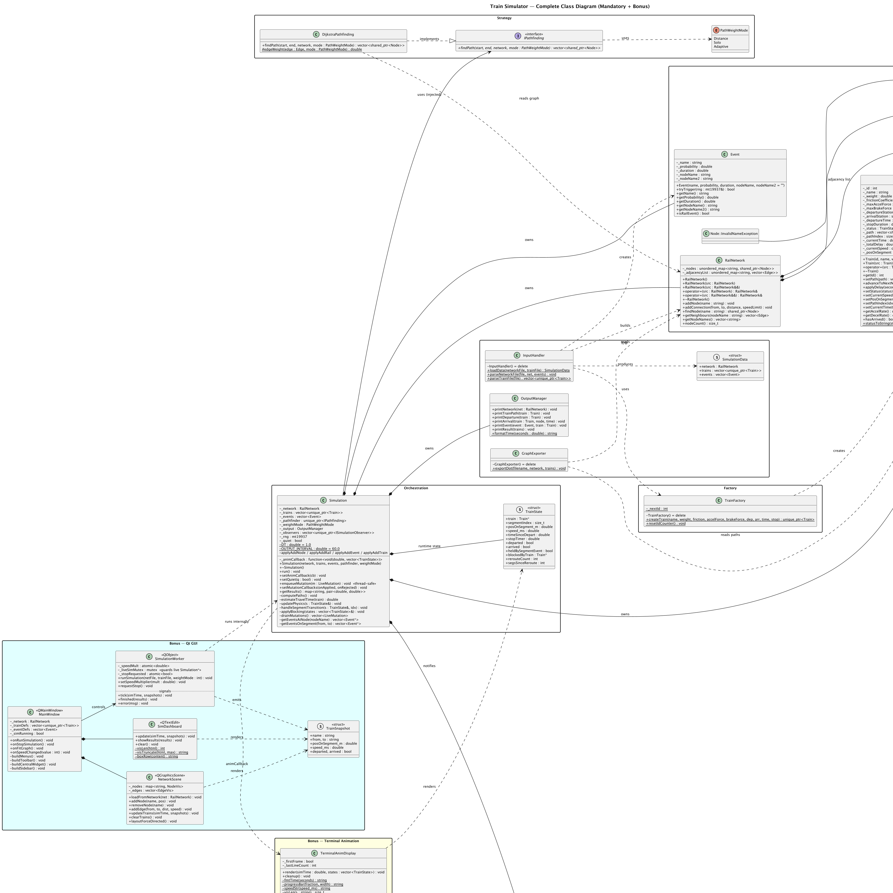

SVG: [class_diagram.svg](diagrams/class_diagram.svg) · Source: [class_diagram.puml](diagrams/class_diagram.puml)

---

## State Machine — Train Lifecycle

Shows how a train transitions through states: Waiting → Running → Stopped/Delayed → Arrived. (A GUI stop aborts the run via an exception; there is no `Aborted` status.)

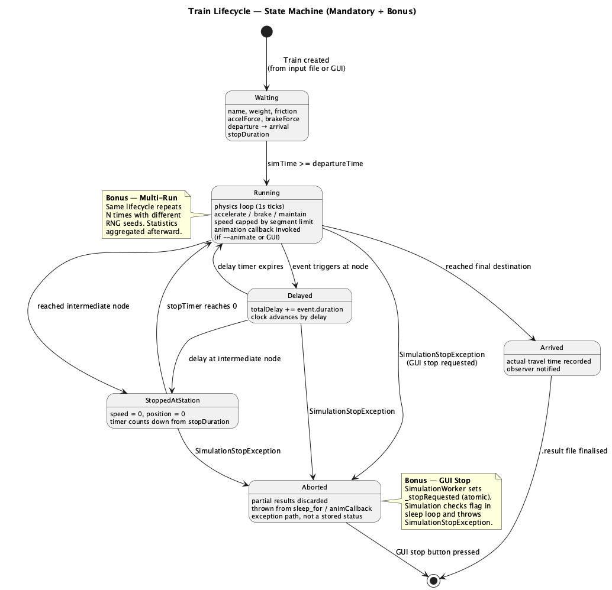

SVG: [state_train_lifecycle.svg](diagrams/state_train_lifecycle.svg) · Source: [state_train_lifecycle.puml](diagrams/state_train_lifecycle.puml)

---

## Activity — Physics Engine (Single Tick)

The decision flowchart for each 1-second physics tick: brake, accelerate, or maintain. Includes bonus animation callback and stop flag check.

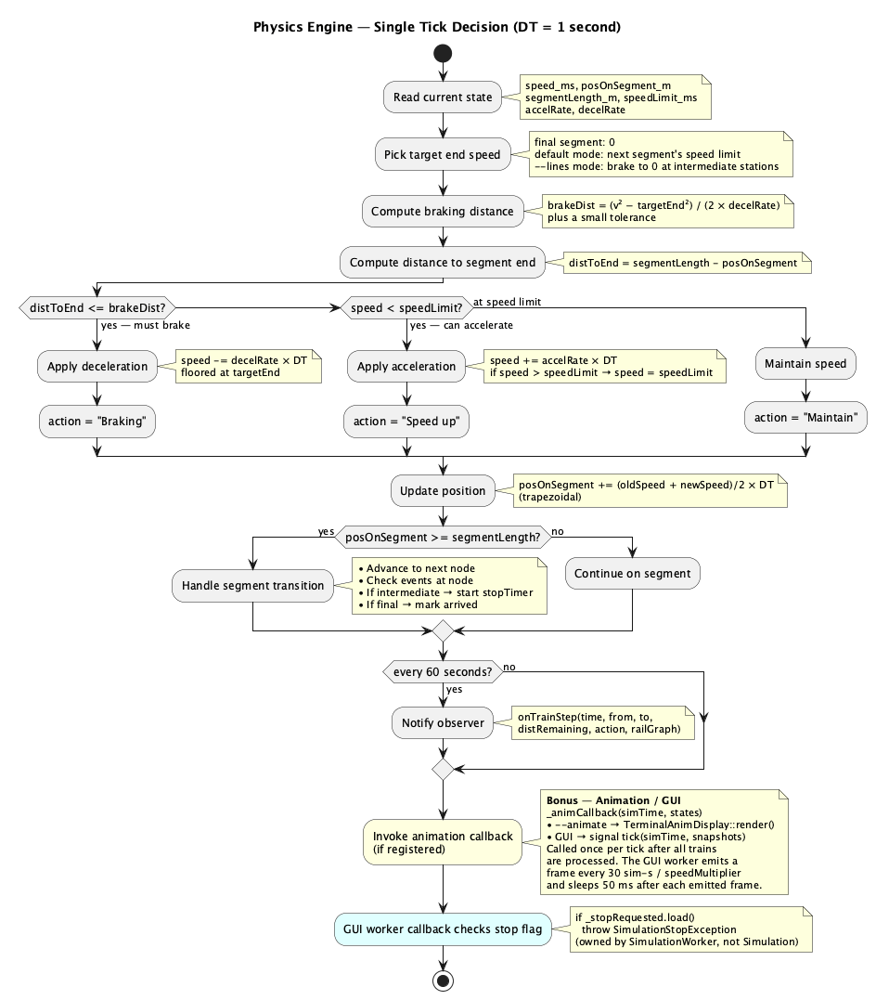

SVG: [activity_physics_tick.svg](diagrams/activity_physics_tick.svg) · Source: [activity_physics_tick.puml](diagrams/activity_physics_tick.puml)

---

## Activity — Simulation Overview

End-to-end flow: loading → initialisation → concurrent physics loop → finalisation. Includes bonus branches for `--graph`, `--animate`, `--runs N`, and GUI stop.

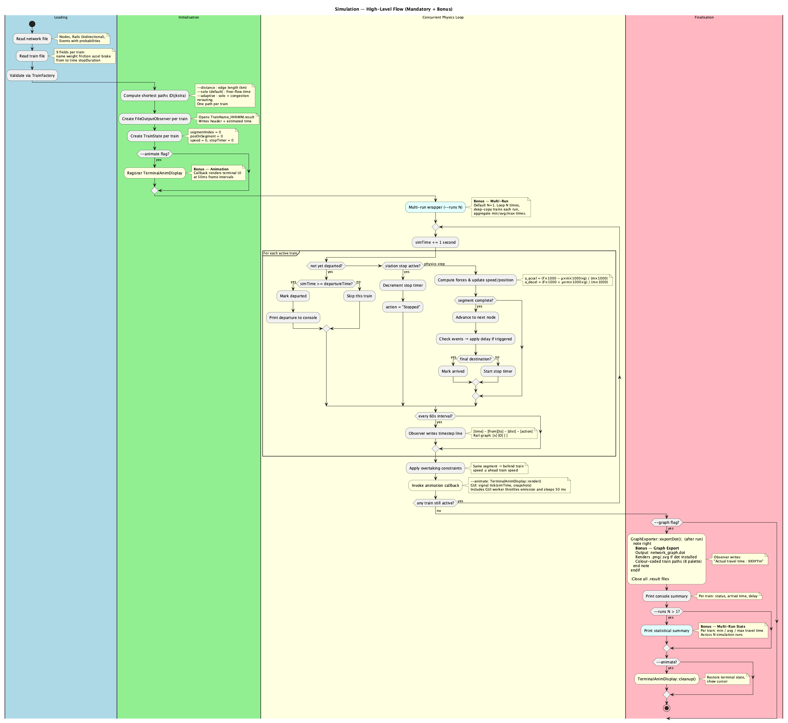

SVG: [activity_simulation_overview.svg](diagrams/activity_simulation_overview.svg) · Source: [activity_simulation_overview.puml](diagrams/activity_simulation_overview.puml)

---

## Sequence — Full Simulation Run

Complete lifecycle: loading → path computation → train simulation → results. Shows CLI and GUI paths, animation callback, graph export, multi-run wrapper.

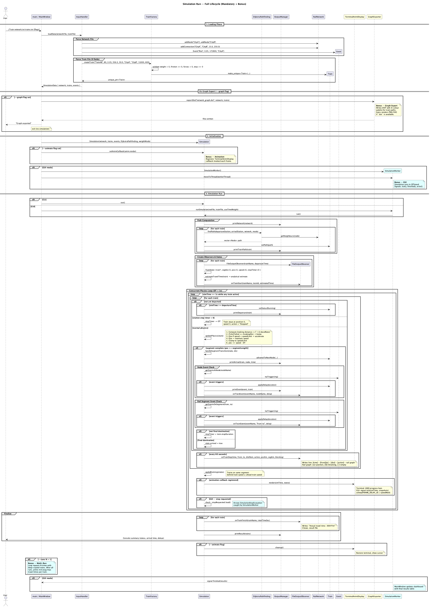

SVG: [sequence_simulation_run.svg](diagrams/sequence_simulation_run.svg) · Source: [sequence_simulation_run.puml](diagrams/sequence_simulation_run.puml)

---

## Sequence — Input Parsing

Details how the two input files are parsed into the domain model, including duration/time parsing, factory validation, and the GUI's deferred parsing path.

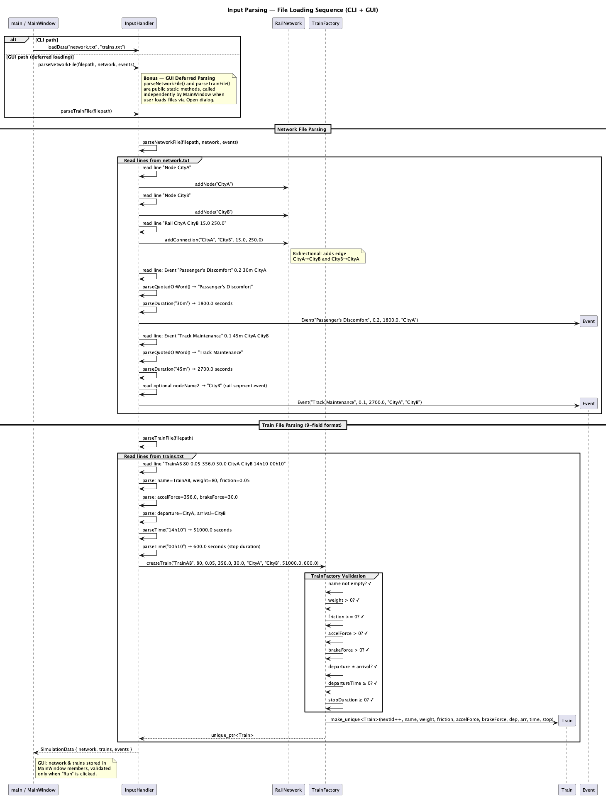

SVG: [sequence_input_parsing.svg](diagrams/sequence_input_parsing.svg) · Source: [sequence_input_parsing.puml](diagrams/sequence_input_parsing.puml)

---

## Sequence — Dijkstra Pathfinding

The shortest-path algorithm: validation, priority queue loop, and path reconstruction, including the edge costs for Distance, Solo, and Adaptive.

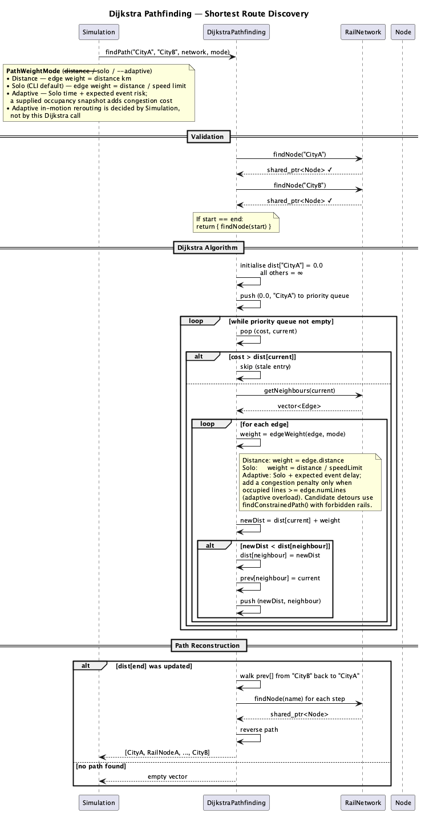

SVG: [sequence_pathfinding.svg](diagrams/sequence_pathfinding.svg) · Source: [sequence_pathfinding.puml](diagrams/sequence_pathfinding.puml)

---

<a id="path-weight-modes"></a>
## Activity — Path-Weight Modes

Shows what Distance, Solo, and Adaptive optimize, and separates Adaptive's
initial route cost from its later in-motion rerouting decisions.

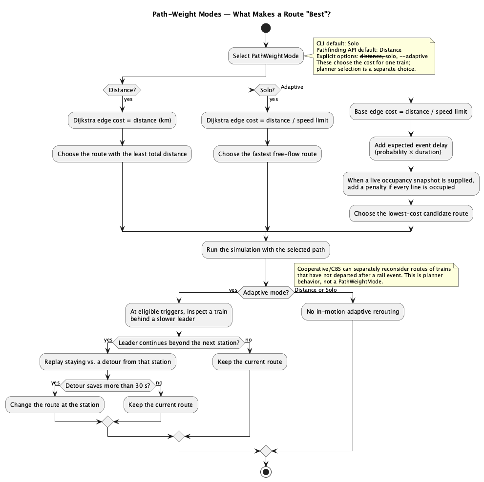

SVG: [activity_path_weight_modes.svg](diagrams/activity_path_weight_modes.svg) · Source: [activity_path_weight_modes.puml](diagrams/activity_path_weight_modes.puml)

---

<a id="fleet-planner-modes"></a>
## Activity — Fleet Planner Modes

Explains Independent, Cooperative, and CBS planning, plus the five variants
run by `--compare`. A fleet planner is a separate choice from path weighting.

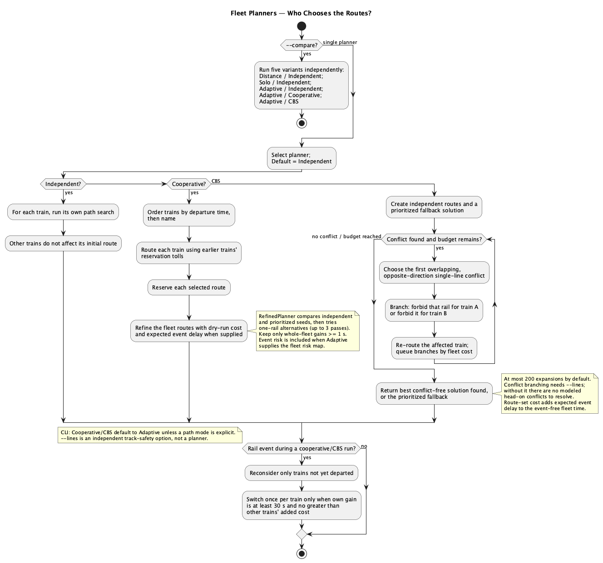

SVG: [activity_fleet_planner_modes.svg](diagrams/activity_fleet_planner_modes.svg) · Source: [activity_fleet_planner_modes.puml](diagrams/activity_fleet_planner_modes.puml)

---

<a id="fleet-planning-sequence"></a>
## Sequence — Fleet Planning and Adaptive Execution

Shows how each planner obtains and evaluates routes, followed by event-driven
replanning, Adaptive in-motion detours, and the optional `--lines` admission
step during the simulation.

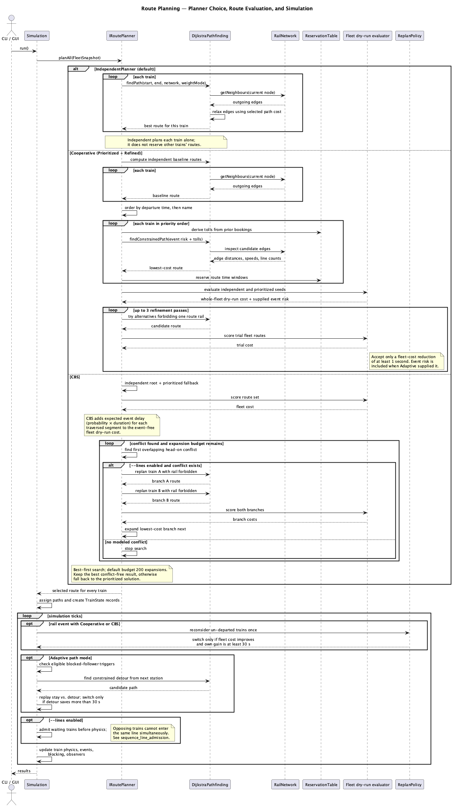

SVG: [sequence_fleet_planning.svg](diagrams/sequence_fleet_planning.svg) · Source: [sequence_fleet_planning.puml](diagrams/sequence_fleet_planning.puml)

---

## Bonus — Multiple Lines per Edge

These two diagrams cover the opt-in `--lines` behavior. They apply to any
multi-line network; they are not specific to the Greater Lisbon sample.

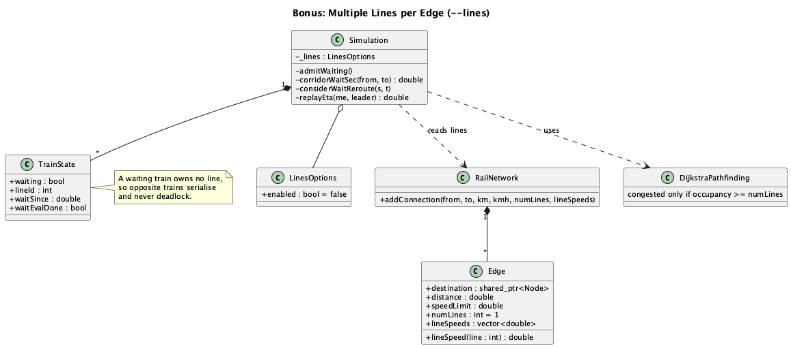

SVG: [class_lines.svg](diagrams/class_lines.svg) · Source: [class_lines.puml](diagrams/class_lines.puml)

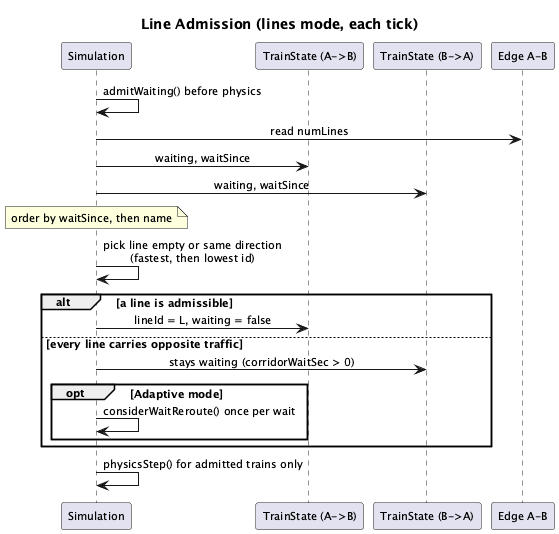

SVG: [sequence_line_admission.svg](diagrams/sequence_line_admission.svg) · Source: [sequence_line_admission.puml](diagrams/sequence_line_admission.puml)

---

## Regenerating Diagrams

To regenerate PNGs and SVGs from the `.puml` sources (requires [PlantUML](https://plantuml.com/)):

```bash
cd docs/diagrams
PLANTUML_LIMIT_SIZE=16384 plantuml -tpng *.puml
PLANTUML_LIMIT_SIZE=16384 plantuml -tsvg *.puml
```

> **Note:** `PLANTUML_LIMIT_SIZE=16384` raises the default 4096 px pixel cap so the class diagram renders at full resolution.
