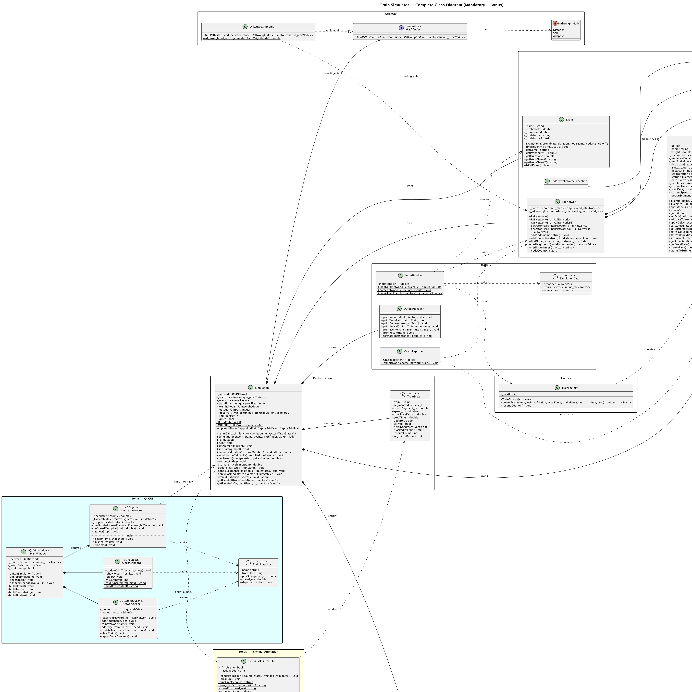
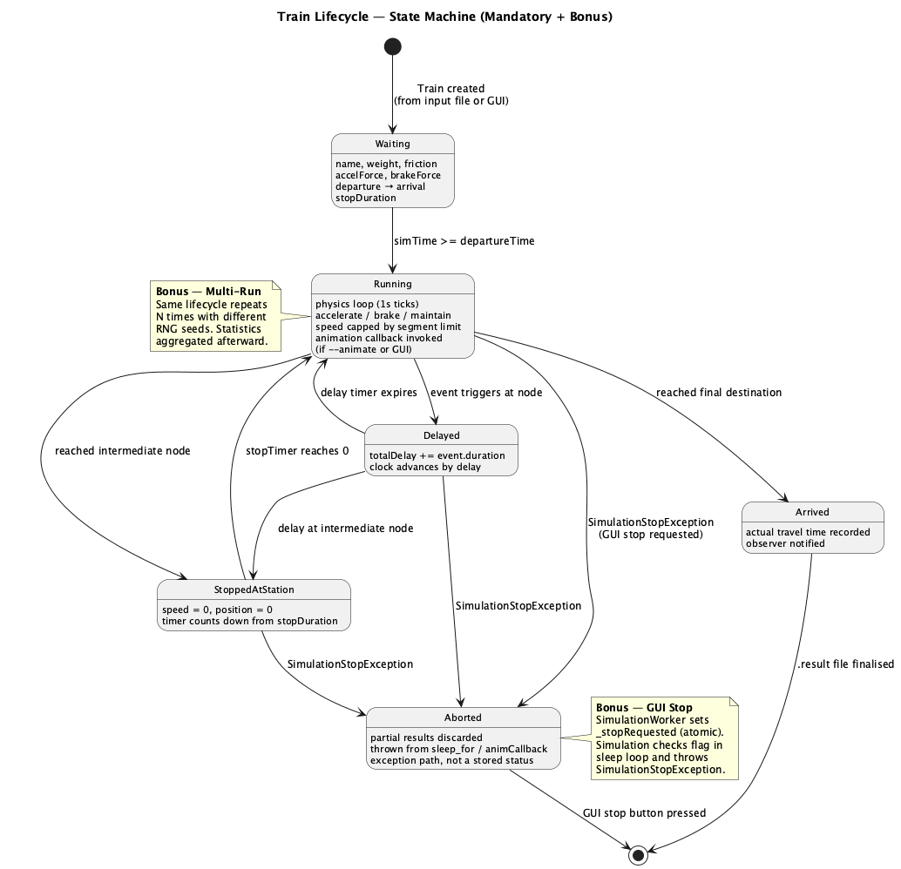
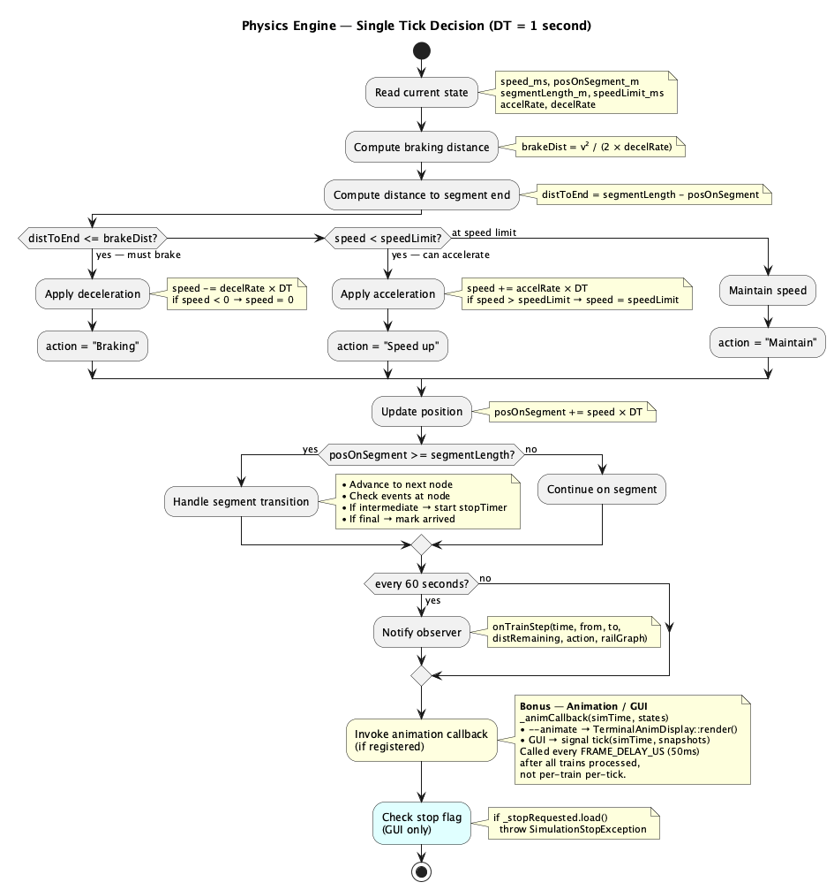
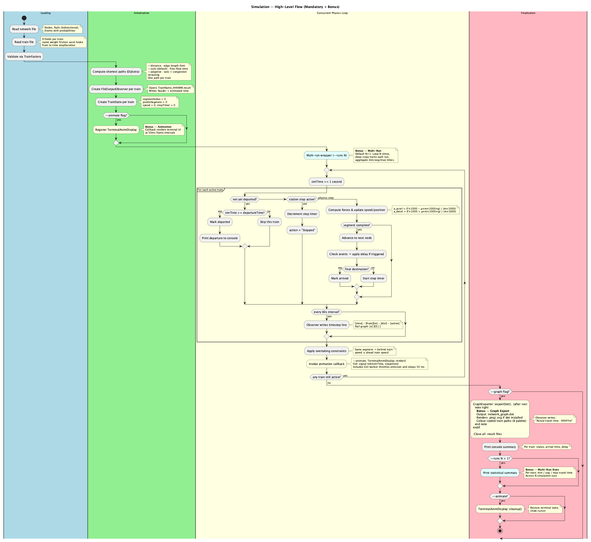
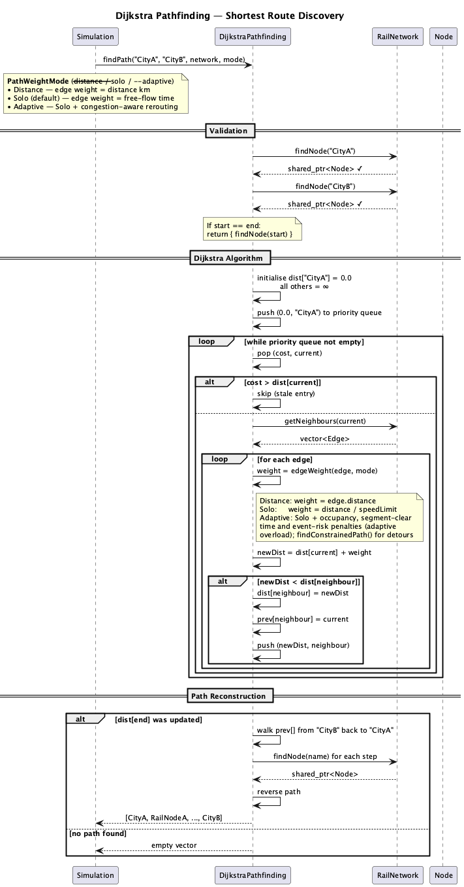
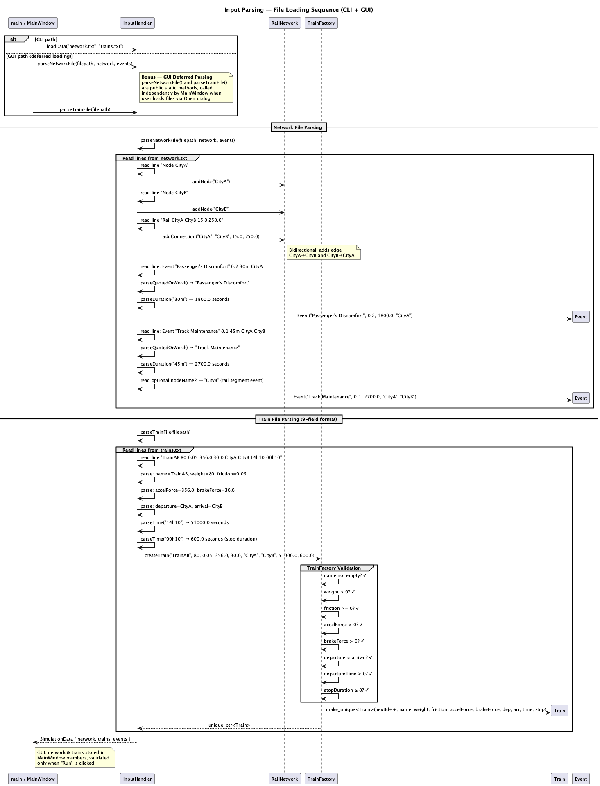
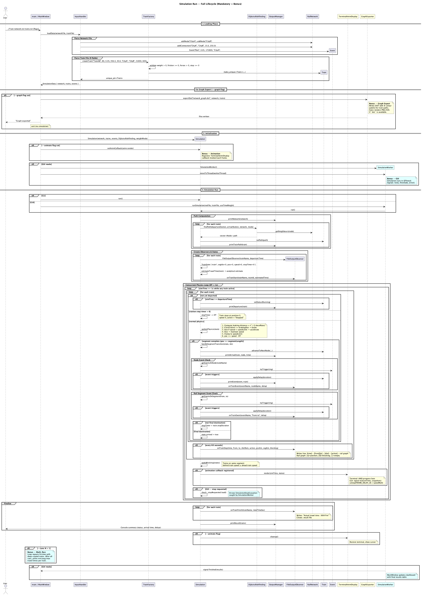

# The Diagrams, Explained in Plain English

This page walks through every diagram in [`docs/diagrams/`](diagrams/) without any programming knowledge.
Its twin, [DIAGRAMS_EXPLAINED_CODE.md](DIAGRAMS_EXPLAINED_CODE.md), follows the **same sections in the same order** and shows the exact code behind each idea.

**The big picture in one paragraph.** We are building a *model railway on a computer*. You describe a map (cities and the tracks between them), some trains (how heavy and powerful they are, where they go and when they leave) and, optionally, things that can go wrong (a signal failure, a strike). The program then "plays" the day second by second, moves every train like a real one would move, and writes down what happened to each train in a text file.

---

## 1. The Cast (class diagram)

📄 `class_diagram.png` · code twin: section 1

Think of the program as a small company where every employee has one job.

| Who | Plain-English job |
|---|---|
| **RailNetwork** | The map: a list of cities and the tracks joining them. |
| **Node** | One city / station. |
| **Edge** | One track between two cities: how long it is and how fast trains may go on it. |
| **Train** | One train: weight, engine power, brake power, where it starts and ends, when it leaves, how long it waits at stations. |
| **Event** | Something that *might* go wrong ("signal failure, 30 % chance, costs 10 minutes"). |
| **InputHandler** | Reads the text files and builds the map, trains and events. Refuses nonsense. |
| **TrainFactory** | Checks each train is sane (no negative weight, no "go from A to A") before it is allowed to exist. |
| **DijkstraPathfinding** | The satnav: finds the best route between two cities. |
| **Simulation** | The referee and the clock. Moves every train, one second at a time. |
| **TrainState** | The referee's notepad for one train *right now*: where it is, how fast, whether it is waiting. |
| **FileOutputObserver** | A diary-keeper. Each train gets its own diary file. |
| **OutputManager** | Prints things on the screen. |
| **TrainResult** | The final score card of a train: expected time, real time, total delay. |

Extras (the "bonus" part): a terminal animation, a graphical window (GUI), and a tool that draws the map as a picture.

---

## 2. A Train's Life (state diagram)

📄 `state_train_lifecycle.png` · code twin: section 2

A train is always in one of four situations:

1. **Waiting** – at its first station, not yet time to leave.
2. **Running** – on the move.
3. **Delayed** – on the move but forced to go slower, because the train in front is slower. (Just like being stuck behind a lorry.) This label is re-checked every second; when the road clears it goes back to *Running*.
4. **Arrived** – finished; its diary is closed.

Two things look like states but are not:

- **Waiting at a station.** At a middle station the train simply stands still for its "stop time". The train is still *Running* as far as the program is concerned; it just has a countdown (a stop-watch) that must reach zero before it moves again. The same stop-watch is used when an Event (e.g. signal failure) holds the train.
- **Pressing "Stop" in the window.** That is not something that happens to the train; it cancels the whole simulation.

---

## 3. One Second of Physics (activity diagram)

📄 `activity_physics_tick.png` · code twin: section 3

Every simulated second, for every moving train, the referee asks the same questions:

1. **Where am I going next?** If this is the last track, I must end up stopped. If not, I only need to slow down to the speed limit of the *next* track (no point stopping at every junction).
2. **How much road do I need to slow down?** Heavy trains and weak brakes need more.
3. **Am I close enough that I must brake now?** If yes → brake.
4. **Otherwise, am I below the speed limit?** If yes → accelerate (a heavy train accelerates slowly).
5. **Otherwise** → keep the current speed.
6. **Move forward** using the average of the speed at the start and end of the second (more accurate than using just one).
7. **Did I reach the end of this track?** If so: I arrived at a station. Check if something goes wrong there; if it was the final station, I'm done; otherwise start the stop-watch and move on to the next track.
8. **Once a minute** write a line in the train's diary.
9. **If an animation or window is watching,** tell it the new positions.

That is the *entire* physics: accelerate, cruise, brake, repeat.

---

## 4. The Whole Run, Start to Finish (activity diagram)

📄 `activity_simulation_overview.png` · code twin: section 4

1. **Read the map file and the train file.** Reject anything invalid with a clear message.
2. **Choose a route for every train** (see section 5).
3. **Prepare a diary file per train** and compute a "best-case" time estimate (an ideal run with no traffic and no events).
4. **Run the clock.** Each second: let trains that are due depart, move every train, let faster trains reroute if allowed, enforce "no driving through the train ahead", update the animation.
5. **Stop when every train has arrived.**
6. **Finish:** close the diaries, print a summary table, and (if asked) draw the map as a picture. The picture is drawn *after* the run because it shows the routes the trains actually took.
7. **Optional:** repeat the whole thing N times with different luck and report fastest / average / slowest.

---

## 5. Choosing a Route (sequence diagram)

📄 `sequence_pathfinding.png` · code twin: section 5

Like a satnav, the program looks for the "cheapest" path, where cheap can mean three things:

| Mode | Cheapest means… |
|---|---|
| `--distance` | the shortest number of kilometres |
| `--solo` (default) | the fastest if the train had the line to itself |
| `--adaptive` | like *solo*, but it adds a "penalty" for tracks that are currently busy or likely to have an Event, and trains may change route mid-journey |

The algorithm (Dijkstra) works like spreading water out from the start city: it always explores the cheapest unexplored city next, so the first time it reaches the destination, it has found the cheapest route.

---

## 6. Reading the Input Files (sequence diagram)

📄 `sequence_input_parsing.png` · code twin: section 6

1. Open the network file, read it line by line. Each line is a city, a track or an event. Anything malformed is rejected with the line number.
2. Open the train file. Each line becomes a train — but only after the checklist passes (positive weight, power and brake force; start ≠ end; no negative times; no duplicate train with the same name and departure time).
3. Cross-check: every train must use cities that exist on the map.

In the graphical version, the window reads the files itself so it can show the map immediately; the simulation reads them again when you press *Run*.

---

## 7. The Full Conversation (sequence diagram)

📄 `sequence_simulation_run.png` · code twin: section 7

This is a "who talks to whom" timeline of a normal run:

1. `main` reads the options you typed (`--animate`, `--runs`, `--graph`, …).
2. The input is loaded; the Simulation is created.
3. `run()` computes routes, then loops second by second. Each second the Simulation tells the train's diary what happened, and, if animation is on, tells the display.
4. At the end each diary gets its final line ("Actual travel time: …") and the screen prints the summary.
5. Then the optional extras: the map picture, the multi-run statistics, or the final results table in the window.

---

## 8. The Rules of the Game (business logic in everyday words)

These are the "why" behind the diagrams.

**Trains cannot pass each other on the same track.** A faster train behind a slower one slows down to match it and keeps a safe gap of 200 m. (Head-on traffic is deliberately not modelled: all trains on a track go the same way.)

**Events are dice rolls.** Each Event has a probability. When a train reaches the place (a city or a track), the program "rolls a die"; if it hits, the train is stopped for the event's duration and the delay is added to its record. A train that is stopped on the open track keeps its place in the queue; the others cannot jump in front of it.

**Stations.** At a middle station every train waits its own stop time. At the final station it simply stops.

**Rerouting (adaptive mode only).** A train that is *faster* than the one ahead of it may look for a different route if the detour is clearly quicker. The program *replays the future* for both choices ("stay behind" vs. "take the detour"), adds the expected cost of events, and switches only if the detour wins by a clear margin. To avoid dithering, a train can reroute at most once every 3 tracks.

**Honest input.** Weird files (negative weights, infinite numbers, a train from A to A, two identical trains) are rejected with a message instead of producing strange results.

**Live changes (GUI).** While a simulation is running you can add a city, a track, an event or a train. They are applied safely between two seconds of simulated time. Adding something impossible (a duplicate, an event on a track that doesn't exist, a train after everything has finished) is politely refused.

**Results.** Each train gets a file `Name_HHhMM.result` with a line per minute and a final summary: estimated time (ideal), actual time, and total delay.
